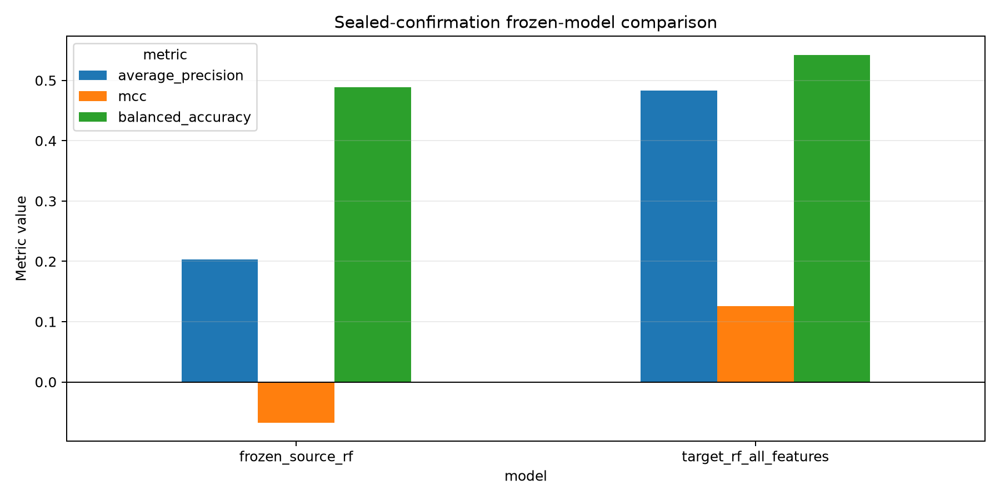
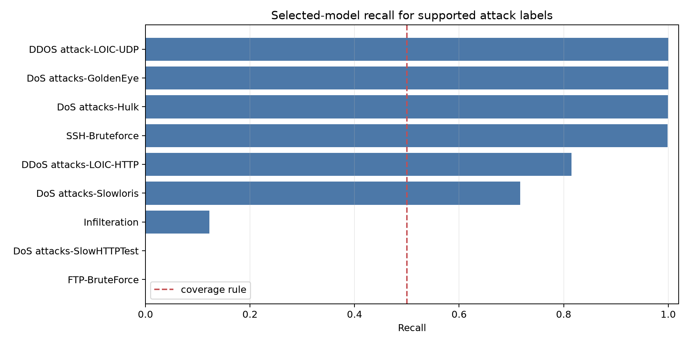

# Fresh Sealed-Confirmation Result

## Material Passport

- Origin Skill: academic-research-suite / experiment-agent
- Origin Mode: run and verification
- Origin Date: 2026-10-23
- Verification Status: VERIFIED against saved local artifacts and integrity checks
- Version Label: sealed_confirmation_result_v1

## Preregistered verdict

**Development improvement not confirmed.**

The frozen target-trained Random Forest was evaluated once on all 1,631,543
sealed-confirmation rows using its unchanged eight-feature pipeline and fixed
threshold of 0.39. It did not meet the preregistered absolute MCC or balanced-
accuracy requirements, and the paired balanced-accuracy interval did not clear
zero. Broad supported-attack coverage also failed. No model, feature, threshold,
row, metric, bootstrap, or decision-rule change was made after confirmation was
opened. No deployment claim is permitted.

## Integrity record

- The unchanged 620,014,585-byte CSV matched SHA-256
  `ed3387646fda24084889f07788cd22da2978b860f5b3d2d6f1210a4e3d7998e0`.
- All 8,392,401 global rows, binary-label totals, and official parent attack
  counts were reproduced.
- Confirmation membership reproduced 1,631,543 rows in 153,825 groups and the
  preregistered ordered digest
  `2eb47d7a15380c5d9e18c9544ca099a0a50d2482128ea3e74a196e88a1bf40b2`.
- The candidate and baseline artifact hashes matched their frozen records.
- The original protocol remains unchanged. Amendment 001 records the
  pre-data model-loading failure; amendment 002 records the dataset-hash typo
  correction. Both failures occurred before confirmation rows were parsed and
  before an execution marker was created, and both retries were explicitly
  authorised.

## Aggregate performance

The confirmation prevalence was 0.22586, compared with 0.06190 in target
validation. Point metrics therefore should be compared with emphasis on MCC,
balanced accuracy, recall, specificity, and AP lift rather than raw AP alone.

| Model | AP | AP lift | MCC | Balanced accuracy | Recall | Specificity | FPR |
|---|---:|---:|---:|---:|---:|---:|---:|
| Frozen source RF, threshold 0.64 | 0.20333 | 0.90025 | -0.06748 | 0.48904 | 0.00184 | 0.97624 | 0.02376 |
| Frozen target RF, threshold 0.39 | 0.48298 | 2.13839 | 0.12593 | 0.54261 | 0.15377 | 0.93146 | 0.06854 |

The target model is better than the source baseline on several measures, but
relative improvement was not the registered success definition. The absolute
candidate gates were MCC at least 0.60 and balanced accuracy at least 0.80;
both failed.

The paired group-bootstrap estimates below are medians across 1,000 resamples,
not substitutions for the full-sample point differences.

| Candidate minus baseline | Bootstrap median | 95% paired interval | Gate |
|---|---:|---:|---|
| MCC | +0.21982 | [0.02543, 0.67550] | Passed: lower bound above 0 |
| Balanced accuracy | +0.06096 | [-0.00706, 0.41195] | Failed: lower bound not above 0 |
| Average Precision | +0.30097 | [0.20894, 0.83724] | Descriptive |

The target-model grouped intervals were wide: bootstrap MCC median 0.15232,
95% interval [-0.06708, 0.64485], and balanced-accuracy median 0.55020,
95% interval [0.48268, 0.90305]. This reflects strong between-group
heterogeneity and reinforces the failed stability claim.

## Preregistered decision rules

| Requirement | Observed result | Pass |
|---|---:|:---:|
| Candidate MCC at least 0.60 | 0.12593 | No |
| Candidate balanced accuracy at least 0.80 | 0.54261 | No |
| Candidate AP lift above 1.00 | 2.13839 | Yes |
| Paired MCC-difference interval lower bound above 0 | 0.02543 | Yes |
| Paired balanced-accuracy-difference interval lower bound above 0 | -0.00706 | No |
| Candidate FPR no greater than 0.10 | 0.06854 | Yes |
| Recall at least 0.50 for every attack with at least 100 rows | minimum 0.00000 | No |

Because the aggregate rule required every one of its five conditions, the
registered aggregate verdict failed. The coverage rule also failed.

## Attack-label recall

The coverage rule applied to the nine labels with at least 100 positive rows.
All observed attack labels are retained below; small labels are reported but
were not used in the coverage decision.

| Attack label | Positive rows | Recall | Coverage-rule eligible |
|---|---:|---:|:---:|
| Bot | 12 | 0.33333 | No |
| Brute Force -Web | 21 | 0.71429 | No |
| Brute Force -XSS | 17 | 0.82353 | No |
| DDOS attack-HOIC | 42 | 0.69048 | No |
| DDOS attack-LOIC-UDP | 337 | 1.00000 | Yes |
| DDoS attacks-LOIC-HTTP | 146 | 0.81507 | Yes |
| DoS attacks-GoldenEye | 5,566 | 1.00000 | Yes |
| DoS attacks-Hulk | 21,314 | 0.99916 | Yes |
| DoS attacks-SlowHTTPTest | 105,550 | 0.00000 | Yes |
| DoS attacks-Slowloris | 7,889 | 0.71707 | Yes |
| FTP-BruteForce | 193,360 | 0.00000 | Yes |
| Infilteration | 12,053 | 0.12221 | Yes |
| SQL Injection | 10 | 0.00000 | No |
| SSH-Bruteforce | 22,183 | 0.99865 | Yes |

The spelling `Infilteration` follows the source CSV. The near-binary pattern
across large attack labels is a warning that the aggregate score is dominated
by attack composition rather than broad, consistent coverage.

## Overfitting and generalisation interpretation

| Candidate metric | Target validation | Sealed confirmation | Change |
|---|---:|---:|---:|
| Average Precision | 0.91443 | 0.48298 | -0.43145 |
| MCC | 0.71401 | 0.12593 | -0.58807 |
| Balanced accuracy | 0.93047 | 0.54261 | -0.38786 |
| Recall | 0.90076 | 0.15377 | -0.74699 |
| False-positive rate | 0.03981 | 0.06854 | +0.02873 |

The high development score was not independently reproduced. This is direct
evidence of a severe development-to-confirmation generalisation gap and makes
the development result unsafe to trust as a stable performance estimate.
It is consistent with development-specific overfitting, but the experiment
does not isolate one mechanism. The partitions had different attack
prevalence and attack composition; the grouping rule controls the registered
five-significant-digit feature groups but cannot represent unknown temporal,
host, session, or campaign dependence. The correct claim is therefore that
the development result was unstable under the sealed split, not that one
specific form of overfitting has been proven causal.

## Eleven-fallacy audit

1. **Data leakage:** no confirmation row was used for fitting or threshold
   selection; frozen hashes and the no-fit runner were verified.
2. **Repeated test-set tuning:** the confirmation was executed once after two
   documented pre-row-access technical failures; no result-driven retry or
   tuning occurred.
3. **Metric cherry-picking:** every preregistered aggregate and coverage gate is
   reported, including failures.
4. **Threshold optimisation on confirmation:** threshold 0.39 was frozen from
   calibration and unchanged.
5. **Candidate reselection:** only the previously selected target Random Forest
   was tested as the candidate.
6. **Duplicate independence:** splitting and bootstrapping use the registered
   coarsened feature groups, while broader unresolved dependence is retained as
   a limitation.
7. **Prevalence neglect:** AP lift and the large prevalence change are reported;
   raw AP is not treated as sufficient evidence.
8. **Aggregate masking:** every attack-label recall is reported, and the
   separate broad-coverage rule fails.
9. **Uncertainty neglect:** 1,000 paired group-bootstrap resamples are reported;
   the wide candidate intervals are not hidden.
10. **Post-hoc causal attribution:** overfitting and composition shift are
    presented as possible explanations, not proven causes.
11. **External-validity inflation:** the result concerns one sealed partition
    of NF-CSE-CIC-IDS2018 and does not support production deployment.

## Evidence

- `../../artifacts/fresh_confirmation_evaluation/summary.json`
- `../../artifacts/fresh_confirmation_evaluation/metrics_long.csv`
- `../../artifacts/fresh_confirmation_evaluation/group_bootstrap_intervals.csv`
- `../../artifacts/fresh_confirmation_evaluation/paired_bootstrap_intervals.csv`
- `../../artifacts/fresh_confirmation_evaluation/per_attack_recall.csv`
- `../../artifacts/fresh_confirmation_evaluation/plots/confirmation_metric_comparison.png`
- `../../artifacts/fresh_confirmation_evaluation/plots/selected_attack_recall.png`

## Interpretation boundary

The exact preregistered verdict is `development improvement not confirmed`.
The candidate remains better than the frozen source model on some metrics, so
the result does not show that target retraining has no value. It shows that the
large development claim was not stable enough to satisfy the confirmation
rule, broad attack coverage was not achieved, and deployment is not supported.
