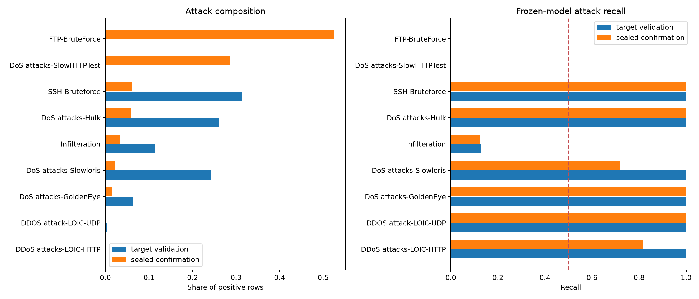
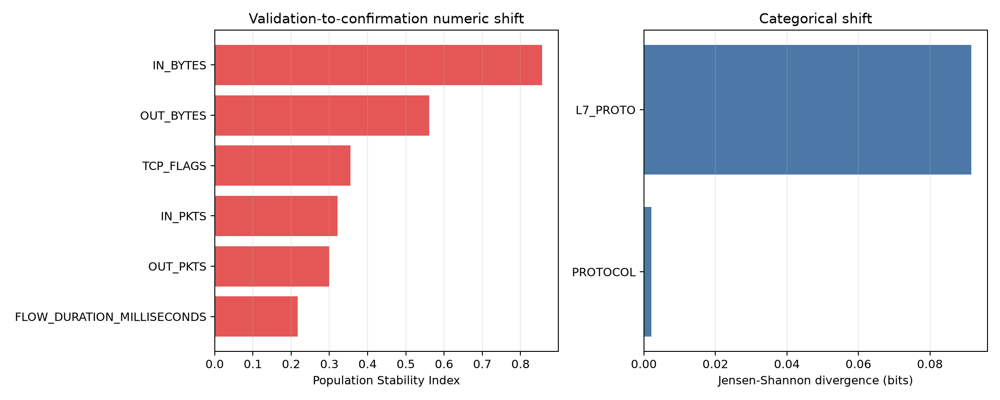
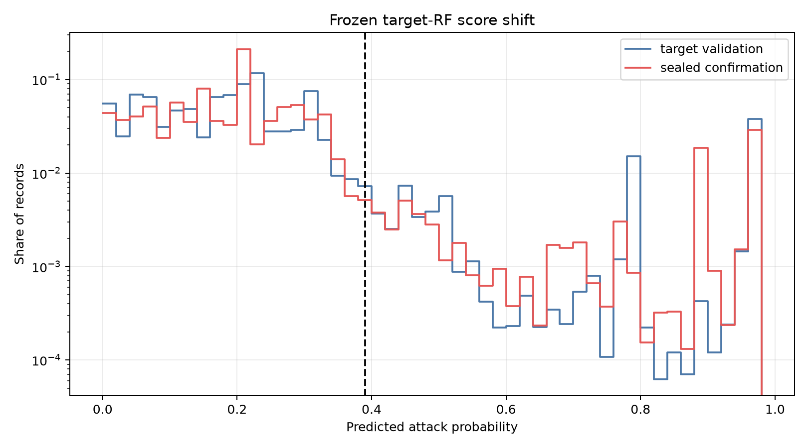
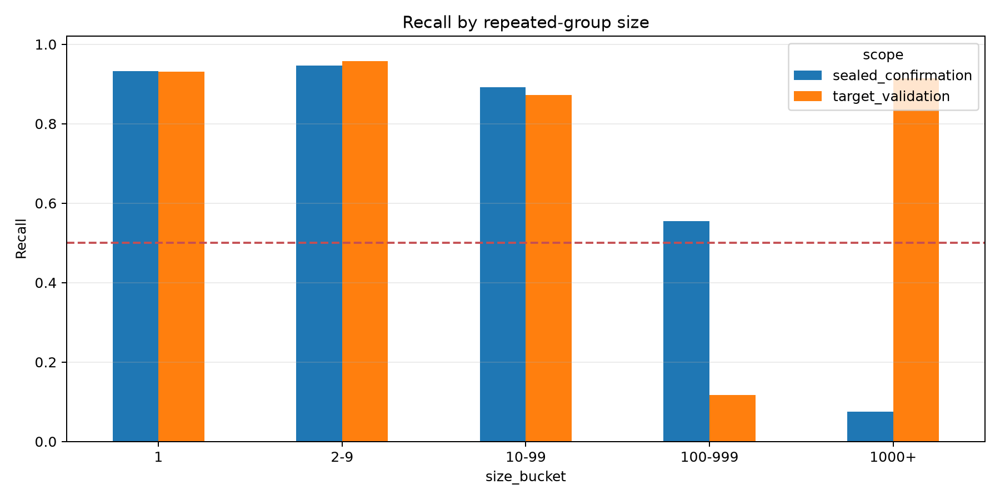

# Fresh Generalisation-Failure Audit

## Material Passport

- Origin Skill: academic-research-suite / experiment-agent
- Origin Mode: run and validate
- Origin Date: 2026-10-26
- Verification Status: VERIFIED
- Version Label: fresh_generalisation_failure_audit_v1

## Outcome

The frozen target Random Forest's saved validation and confirmation metrics were
reproduced exactly. The audit found that the confirmation failure is strongly
associated with attack-composition change, very large repeated feature groups,
feature-distribution shift, feature/label association drift, and loss of frozen-
score class separation. The evidence does not support describing the failure as
a hyperparameter problem alone.

This is a post-hoc diagnostic. It generates version-2 hypotheses but does not
validate a correction or authorise tuning on confirmation.

## Main finding: two unseen validation attacks dominate confirmation

FTP-BruteForce and DoS attacks-SlowHTTPTest were absent from the registered
400,087-row sampled validation partition. In confirmation they contributed
193,360 and 105,550 attacks respectively, representing 52.47% and 28.64% of all
confirmation attacks. Together they formed **81.12% of confirmation attacks**,
and the frozen model recalled **0% of both**.

| Attack label | Validation attack share | Validation recall | Confirmation attack share | Confirmation recall |
|---|---:|---:|---:|---:|
| FTP-BruteForce | 0.00% | Not represented | 52.47% | 0.00% |
| DoS attacks-SlowHTTPTest | 0.00% | Not represented | 28.64% | 0.00% |
| SSH-Bruteforce | 31.36% | 100.00% | 6.02% | 99.86% |
| DoS attacks-Hulk | 26.12% | 99.97% | 5.78% | 99.92% |
| Infilteration | 11.35% | 12.77% | 3.27% | 12.22% |
| DoS attacks-Slowloris | 24.29% | 100.00% | 2.14% | 71.71% |

This means the high validation recall was driven by a substantially different
attack mixture and did not test the two families that dominated confirmation.

## Repeated-group concentration

The registered five-significant-digit feature groups are extremely uneven.

| Scope | Groups | Maximum group size | Rows in largest 1% of groups | Attacks in largest 1% of groups | Recall for groups with 1,000+ rows |
|---|---:|---:|---:|---:|---:|
| Target validation | 46,022 | 38,416 | 76.18% | 63.11% | 91.37% |
| Sealed confirmation | 153,825 | 299,081 | 80.28% | 91.63% | 7.57% |

Confirmation recall remained between 89.12% and 94.66% for groups smaller than
100 rows, fell to 55.45% for groups of 100–999 rows, and fell to 7.57% for groups
with at least 1,000 rows. Large repeated patterns, not isolated rare records,
therefore dominate the missed attacks.

Mixed-label groups covered 43.56% of validation rows and 57.92% of confirmation
rows. Rows with the same coarsened eight-feature representation can therefore
carry different labels. This is evidence that the representation and grouping
are insufficient to separate every observed label consistently; it is not
evidence that adding model complexity will resolve the ambiguity.

## Feature and relationship shift

The largest numeric distribution changes were:

| Feature | PSI | KS statistic |
|---|---:|---:|
| `IN_BYTES` | 0.85590 | 0.25370 |
| `OUT_BYTES` | 0.56075 | 0.18878 |
| `TCP_FLAGS` | 0.35510 | 0.24164 |
| `IN_PKTS` | 0.32097 | 0.23656 |
| `OUT_PKTS` | 0.29992 | 0.18878 |
| `FLOW_DURATION_MILLISECONDS` | 0.21707 | 0.19534 |

`L7_PROTO` also shifted: its Jensen-Shannon divergence was 0.09152 bits and the
share of value `0.0` increased from 50.99% to 73.44%.

Prevalence-adjusted feature/label relationships also changed. The largest
confirmation-weighted absolute relative log-odds drift was 1.82028 for
`TCP_FLAGS`, followed by 1.17370 for `IN_BYTES` and 0.96076 for `IN_PKTS`.
These results show that the same feature regions do not carry stable label
meaning across the two partitions.

## Frozen-score collapse

| Scope | Normal mean score | Attack mean score | Attack-minus-normal margin | Predicted-positive rate |
|---|---:|---:|---:|---:|
| Target validation | 0.18722 | 0.85161 | +0.66439 | 9.31% |
| Sealed confirmation | 0.20755 | 0.32343 | +0.11588 | 8.78% |

At the unchanged threshold of 0.39, confirmation prevalence increased from
6.19% to 22.59%, but the predicted-positive rate decreased slightly. The attack
mean probability fell by 0.52818 and the class-separation margin contracted by
0.54851. Threshold adjustment alone cannot restore attacks whose frozen scores
overlap heavily with Normal traffic without also increasing false positives.

## Interpretation

The audit supports four linked explanations:

1. sampled validation did not cover two attack labels that dominated
   confirmation;
2. confirmation attacks are highly concentrated in very large repeated groups;
3. the eight-feature distribution and its relationship with the label changed;
   and
4. the frozen model's attack-versus-Normal score separation collapsed.

These observations are consistent with development-specific overfitting and a
non-representative validation mixture, but they do not establish one unique
causal mechanism. The result should not be simplified to “the Random Forest
needs different hyperparameters.”

## Version-2 implications

A version-2 research prototype should be permitted to proceed only under a new
development protocol. The audit suggests these priorities:

1. require supported attack-family coverage in every development evaluation;
2. weight or sample by attack family and repeated group, not only the binary
   label;
3. select candidates using worst-supported-family recall alongside MCC,
   balanced accuracy and false-positive rate;
4. treat very large or mixed-label groups explicitly rather than allowing them
   to dominate aggregate metrics;
5. investigate richer non-endpoint features because the present eight-feature
   representation contains extensive label ambiguity; and
6. reserve genuinely new data for any independent version-2 confirmation.

## Evidence

- `../../protocols/fresh_generalisation_failure_audit.json`
- `../../artifacts/fresh_generalisation_failure_audit/summary.json`
- `../../artifacts/fresh_generalisation_failure_audit/attack_mix_and_recall.csv`
- `../../artifacts/fresh_generalisation_failure_audit/group_size_profiles.csv`
- `../../artifacts/fresh_generalisation_failure_audit/model_score_shift.csv`
- `../../artifacts/fresh_generalisation_failure_audit/numeric_distribution_shift.csv`
- `../../artifacts/fresh_generalisation_failure_audit/feature_label_association_drift.csv`

## Interpretation boundary

The audit uses data already opened during confirmation. Its findings may inform
a new hypothesis and development plan, but they cannot validate a correction,
convert confirmation back into an independent test, or establish real-world
deployment readiness.
