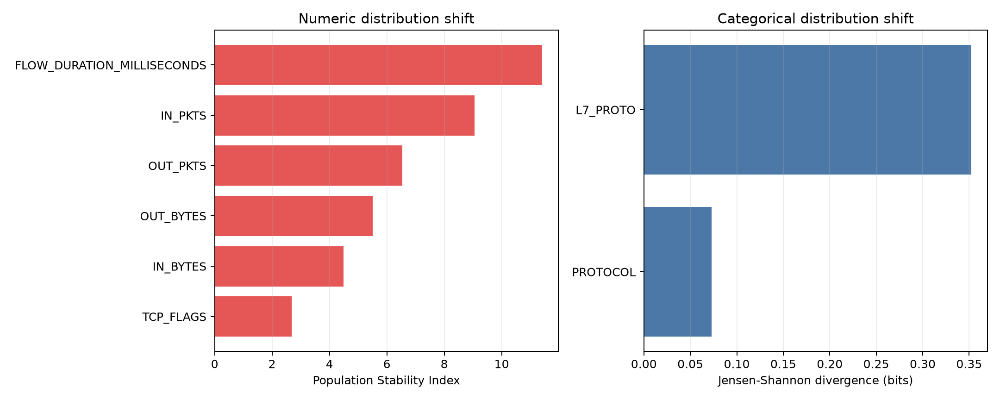
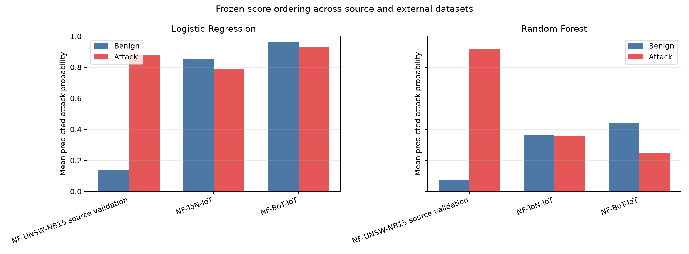
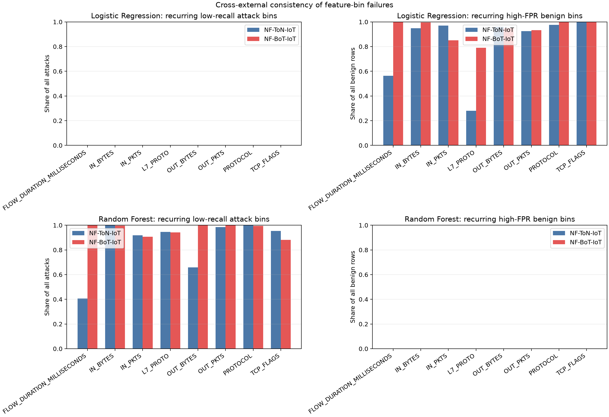
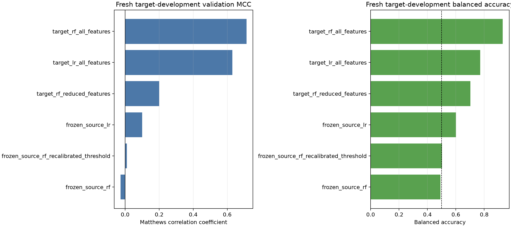
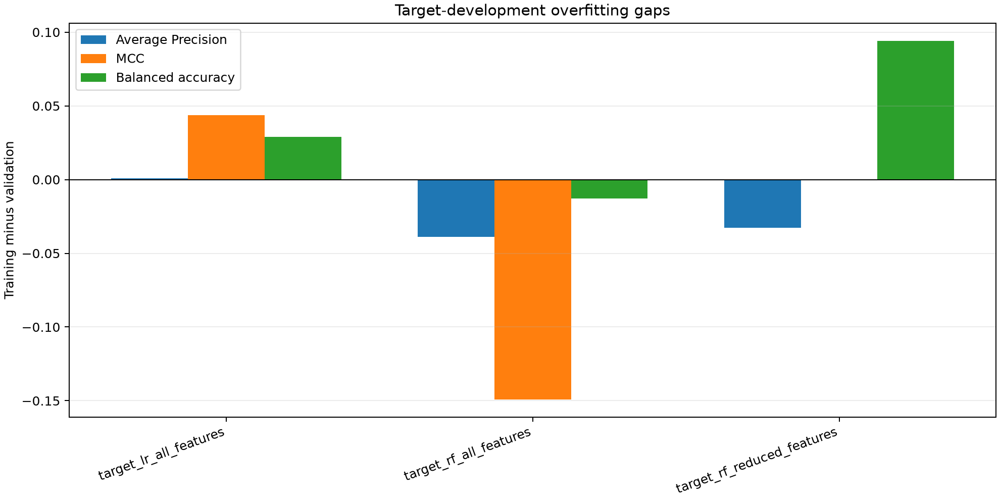

# Current Results and Discussion

## Scope and status

This document consolidates the completed modelling work after the graded
methodology stage. It reports the evidence produced by the current codebase and
does not alter the previously submitted methodology report or slides. The final
model is a Random Forest with 200 trees, maximum depth 24, minimum leaf size 5,
and `sqrt` feature sampling. The final feature set excludes `sttl`, `dttl`, and
`ct_state_ttl`, and the decision threshold is fixed at 0.54. These choices were
made using development data before the supplied test set was opened.

The main result is more nuanced than the validation score initially suggested.
The model retains excellent attack-ranking performance on the conservative
holdout, but the fixed decision threshold produces too many false alarms for a
deployment claim. A matched-representation external stress test strengthens
this warning: models that remained strong on an endpoint-free, duplicate-grouped
NF-UNSW-NB15 validation split failed to generalise to NF-ToN-IoT. A separately
preregistered evaluation on untouched NF-BoT-IoT then failed all three frozen
transfer criteria. Internal overfitting is limited within UNSW-NB15, but the
two external failures show that dataset-specific fitting and distribution shift
remain severe risks. A preregistered target-development experiment on the
previously unused NF-CSE-CIC-IDS2018 dataset identified a promising
target-trained Random Forest, but the completed sealed confirmation did not
reproduce the development claim.

## 1. Model selection and internal validation

Grouped cross-validation selected a regularised Random Forest structure of 200
trees, depth 24, minimum leaf size 5, and `sqrt` feature sampling. The smaller
200-tree model was retained because its performance was practically equivalent
to the 500-tree alternative while requiring less computation. Logistic
Regression remained the interpretable baseline.

On the held-out validation partition, the Random Forest outperformed Logistic
Regression on every primary metric. Average Precision increased from 0.99165 to
0.99649, F1 increased from 0.95423 to 0.96596, and MCC increased from 0.85183 to
0.89206. Paired bootstrap intervals based on five-significant-digit
near-duplicate groups excluded zero for all three improvements:

| Metric | Logistic Regression | Random Forest | RF minus LR | 95% paired bootstrap interval |
|---|---:|---:|---:|---:|
| Average Precision | 0.99165 | 0.99649 | +0.00484 | [0.00404, 0.00574] |
| F1 | 0.95423 | 0.96596 | +0.01174 | [0.00987, 0.01395] |
| MCC | 0.85183 | 0.89206 | +0.04023 | [0.03419, 0.04706] |

The bootstrap probability that the Random Forest was better was 1.00 for each
metric across 1,000 resamples. This supports the choice of the nonlinear model,
but the absolute differences should not be presented as algorithmic novelty.
Random Forest and Logistic Regression have both been studied extensively on
UNSW-NB15. The contribution of this work is the stress-tested evaluation rather
than a new classifier.

## 2. Overfitting assessment

The original all-feature Random Forest achieved training Average Precision of
0.99985 and validation Average Precision of 0.99672, a gap of 0.00313. The
training-to-validation gaps were larger for threshold-dependent metrics: 0.02586
for F1 and 0.08234 for MCC. These gaps show some fitting to development-specific
patterns, but they do not resemble uncontrolled memorisation.

Three results support that interpretation. First, out-of-bag F1 was 0.97085,
close to validation F1 of 0.96697. Second, five-fold grouped cross-validation
produced mean F1 of 0.96613 with a standard deviation of 0.00165. Third, the
grouped learning curve improved slightly as the available training data
increased and did not show a collapsing holdout score. Therefore, the high
validation result was not explained solely by conventional model overfitting.

The more important evidence emerged when the frozen model was evaluated on the
official holdout. For the final no-TTL model, validation and conservative
holdout results differed as follows:

| Metric | Validation | Conservative holdout | Change |
|---|---:|---:|---:|
| Average Precision | 0.99645 | 0.98207 | -0.01438 |
| F1 | 0.96558 | 0.88226 | -0.08332 |
| MCC | 0.89078 | 0.74624 | -0.14454 |
| False-positive rate | 0.08938 | 0.26381 | +0.17443 |

This pattern changes the conclusion. Ranking quality remained strong, but the
operating threshold transferred poorly. The evidence is consistent with a
combination of limited internal overfitting, dataset shift, and threshold
miscalibration. The descriptive audit cannot establish which mechanism is
causal, so the result should not be labelled as pure overfitting or pure concept
drift.

## 3. Shortcut-feature and near-duplicate robustness

The TTL-related variables required a direct stress test because `sttl` showed a
strong association with the target and could reflect the benchmark-generation
setup. Removing `sttl`, `dttl`, and `ct_state_ttl` produced almost no practical
loss on the near-duplicate-grouped robustness split:

| Variant | Average Precision | F1 | MCC |
|---|---:|---:|---:|
| All features | 0.996834 | 0.968233 | 0.899071 |
| Without TTL-related features | 0.996773 | 0.968408 | 0.898988 |
| Difference, no-TTL minus all | -0.000060 | +0.000176 | -0.000083 |

The paired 95% interval for the Average Precision difference was
[-0.000108, -0.000021], showing a statistically detectable but operationally
tiny reduction. The intervals for F1 and MCC crossed zero. This result supports
using the more conservative no-TTL model: nearly all validation performance was
retained without relying on the disputed TTL signals.

The initial exact-row grouping did not remove every near duplicate. Under the
stricter definition, where categorical values remained exact and numeric values
were rounded to five significant digits, 20 groups crossed the original
development-validation boundary and affected 500 validation rows (1.43%). All
500 were Normal and label-consistent. A reconstructed split placed each such
group entirely in one partition. Performance remained high and similar, so the
validation score was not driven by these identified near duplicates. This does
not prove the absence of all semantic or temporal duplication; it tests one
explicit, reproducible definition.

## 4. Frozen holdout performance

The final model was refitted on all 175,341 supplied training records and then
evaluated without further model or threshold changes. Because an older workflow
had already examined a deterministic 5,000-row test sample, the primary scope
excluded those records. It also excluded 8,647 test records whose coarsened
final-feature fingerprints overlapped training. The conservative primary scope
therefore contained 69,222 records.

| Metric | Conservative holdout result | 95% group-bootstrap interval |
|---|---:|---:|
| Average Precision | 0.98207 | [0.98091, 0.98322] |
| Accuracy | 0.86389 | not bootstrapped |
| Precision | 0.80084 | not bootstrapped |
| Recall | 0.98211 | not bootstrapped |
| F1 | 0.88226 | [0.87875, 0.88593] |
| MCC | 0.74624 | [0.74086, 0.75123] |
| False-positive rate | 0.26381 | not bootstrapped |
| Brier score | 0.08965 | not bootstrapped |
| Log loss | 0.25825 | not bootstrapped |

The confusion matrix contained 35,301 true positives, 643 false negatives,
24,499 true negatives, and 8,779 false positives. High recall was therefore
obtained at a substantial alert burden: approximately one in four Normal
records was classified as suspicious. Average Precision of 0.98207 shows that
the model still ranks suspicious records effectively across possible
thresholds. It does not mean that the frozen 0.54 operating point is
deployment-ready.

## 5. Attack-specific performance

Attack recall was high for most categories, but aggregate recall concealed a
clear weakness for Fuzzers:

| Attack category | Support | Detected | Recall |
|---|---:|---:|---:|
| Fuzzers | 5,454 | 4,919 | 0.90191 |
| Exploits | 8,759 | 8,670 | 0.98984 |
| Shellcode | 351 | 348 | 0.99145 |
| DoS | 1,953 | 1,942 | 0.99437 |
| Reconnaissance | 2,226 | 2,222 | 0.99820 |
| Generic | 16,091 | 16,090 | 0.99994 |
| Analysis | 523 | 523 | 1.00000 |
| Backdoor | 546 | 546 | 1.00000 |
| Worms | 41 | 41 | 1.00000 |

Perfect recall for Worms should be interpreted cautiously because it is based
on only 41 observations. The 535 missed Fuzzers attacks account for 83.2% of all
643 false negatives, making this category the principal detection weakness in
the conservative holdout.

## 6. Distribution shift and false-positive analysis

The post-evaluation audit was descriptive and did not retune the model. The
largest numeric Population Stability Index values were observed for `rate`
(0.133), `ct_src_ltm` (0.123), `ct_src_dport_ltm` (0.121), `sbytes` (0.110),
and `sload` (0.106). Among categorical predictors, `proto` showed the greatest
Jensen-Shannon divergence (0.032 bits). TCP prevalence increased from 45.6% in
training to 58.4% in the conservative holdout. The prevalence of `state=INT`
decreased from 46.9% to 35.0%. These measurements show that the input
distribution changed, although they do not prove that any single change caused
the performance gap.

False positives were strongly concentrated in particular traffic patterns.
Among Normal records, `state=INT` had a false-positive rate of 77.0%
(2,173/2,821), `service=ftp` had a rate of 46.9% (333/710), and UDP traffic had
a rate of 30.6% (2,161/7,056). `state=FIN` generated the largest absolute number
of false positives (6,584) because it was much more common, although its
within-group rate was lower at 29.0%. Risk and volume therefore need to be
reported separately.

The score distribution also matters. The mean false-positive probability was
0.709 and the median was 0.702. Only 322 false positives, or 3.67%, had a score
of at least 0.90. Approximately half of the false positives fell between 0.54
and 0.70, indicating that many errors were not extreme predictions. A future
threshold or calibration study could potentially reduce the alert rate, but it
must use new calibration data rather than optimising against this test result.

On a balanced sample of 500 false positives and 500 true negatives, SHAP
identified `ackdat`, `tcprtt`, `synack`, `dload`, `rate`, and `dinpkt` as the
strongest average positive contributors to false alarms. The corresponding raw
feature contrasts were substantial: for example, false positives had median
`ackdat` of 0.0608 compared with 0.000137 for true negatives, and median
`dinpkt` of 95.79 compared with 0.98. These are model-behaviour explanations,
not evidence that the variables cause malicious activity.

## 7. Targeted Fuzzers and `state=INT` error audit

Fuzzers was the weakest supported attack category. In the conservative primary
holdout, 4,919 of 5,454 Fuzzers records were detected and 535 were missed,
giving 90.19% recall. Missed Fuzzers had a median predicted attack probability
of 0.478, compared with 0.792 for detected records. Their 95th percentile was
0.535, immediately below the frozen threshold of 0.54. The errors were
therefore mostly lower-confidence or threshold-adjacent cases rather than
high-confidence Normal predictions.

Among supported categorical groups, 421 of the misses were TCP records, 418
were in `state=FIN`, and 522 had no named service. These counts largely reflect
the composition of Fuzzers traffic: the corresponding miss rates were 12.05%,
11.99%, and 10.54%. UDP Fuzzers had a similar 11.39% miss rate, whereas
`state=INT` Fuzzers had a lower 5.91% miss rate. These overlaps should not be
read as independent risk factors.

The largest numeric separation between missed and detected Fuzzers was
`ct_dst_src_ltm` (medians 4 versus 2; KS statistic 0.413). Missed records also
had lower median `smean` (61 versus 100). In the sampled SHAP comparison,
`ct_dst_src_ltm`, `ct_srv_dst`, `ct_srv_src`, `state`, and `proto` showed the
largest negative signed gaps for misses relative to detections. This means
those features contributed less attack evidence, or more Normal evidence, for
the sampled missed cases; it does not show that they caused the errors.

The Normal `state=INT` subgroup contained 2,821 records, of which 2,173 were
false positives, for a 77.03% false-positive rate. False positives had a median
attack probability of 0.743, compared with 0.404 for the 648 true negatives.
Nearly all records were UDP with no named service, so those categorical labels
do not distinguish the outcomes within this subgroup.

Numeric contrasts were stronger within `state=INT`. False positives had much
lower medians than true negatives for `ct_dst_src_ltm` (4 versus 23; KS 0.547),
`ct_srv_dst` (5 versus 23; KS 0.541), and `ct_srv_src` (5 versus 23; KS 0.492).
The sampled SHAP comparison showed that `smean`, `sbytes`, `ct_srv_dst`,
`ct_srv_src`, and `sload` supplied substantially less negative evidence for
false positives than for true negatives. In other words, their protective
effect was weaker in the false-positive sample. These holdout-derived patterns
are diagnostic hypotheses only and were not converted into subgroup rules.

## 8. Operational alert burden and cost sensitivity

The frozen threshold of 0.54 generated 858.3 false alerts per 10,000 Normal
flows on the internal grouped tuning fold and 893.8 on validation. On the
conservative primary holdout, the burden increased to 2,638.1 false alerts per
10,000 Normal flows. At the same threshold, missed attacks per 10,000
Suspicious flows were 250.3 internally, 274.0 on validation, and 178.9 on the
holdout. The transferred detector therefore caught slightly more attacks on the
holdout while creating roughly three times the Normal-traffic alert burden.

Relative cost scenarios were selected on the internal grouped development fold
only. Equal false-positive and false-negative costs selected the existing 0.54
threshold. Setting a false negative to twice the cost of a false positive
selected 0.43; on validation this produced 1,359.8 false alerts per 10,000
Normal flows and 101.4 missed attacks per 10,000 Suspicious flows. A five-times
false-negative cost selected 0.26, producing 1,957.1 false alerts and 5.4 missed
attacks per 10,000 respective class flows on validation.

Alert-budget policies showed the opposite trade-off. An internal budget of 100
false alerts per 10,000 Normal flows selected 0.84 and yielded 92.0 false alerts
but 1,234.3 missed attacks per 10,000 Suspicious flows on validation. Internal
budgets of 500 and 1,000 selected thresholds of 0.65 and 0.51; their validation
burdens were 519.6 and 1,027.7 false alerts, respectively. The small budget
overshoots after transfer reinforce that a threshold should be calibrated on
fresh, representative data rather than treated as universally portable.

These cost ratios are sensitivity scenarios, not measured organisational
utilities. They make the trade-off explicit but do not identify an acceptable
deployment policy. No candidate threshold from this analysis replaced the
frozen final threshold, and holdout performance was not used for selection.

## 9. External cross-dataset validation

The supplied UNSW-NB15 training and testing files do not contain timestamps,
source or destination addresses, or capture-session identifiers. A defensible
temporal or source-aware reconstruction was therefore not possible from the
local files. The next stress test used the University of Queensland's
standardised NetFlow-v1 versions of NF-UNSW-NB15 and NF-ToN-IoT, which share a
common representation.

This is a new matched-representation experiment rather than a direct external
test of the frozen 44-feature model. Source and destination IP addresses and
ports were excluded to prevent endpoint identity from acting as a shortcut.
The remaining eight traffic features were `PROTOCOL`, `L7_PROTO`, `IN_BYTES`,
`OUT_BYTES`, `IN_PKTS`, `OUT_PKTS`, `TCP_FLAGS`, and
`FLOW_DURATION_MILLISECONDS`. Exact duplicates across those eight features
were kept in one fold. Three folds trained each pre-specified model, a fourth
selected its MCC-maximising threshold, and a fifth remained untouched for
source validation. The 1,379,274 NF-ToN-IoT records were used only after model
fitting and threshold selection were complete.

| Model and scope | Average Precision | MCC | Recall | Specificity | Balanced accuracy |
|---|---:|---:|---:|---:|---:|
| Logistic Regression, NF-UNSW source validation | 0.64834 | 0.64193 | 0.87906 | 0.95890 | 0.91898 |
| Logistic Regression, NF-ToN external | 0.70689 | -0.11699 | 0.69358 | 0.17401 | 0.43380 |
| Random Forest, NF-UNSW source validation | 0.85410 | 0.77629 | 0.99382 | 0.97228 | 0.98305 |
| Random Forest, NF-ToN external | 0.79213 | -0.15243 | 0.04297 | 0.86515 | 0.45406 |

The external attack prevalence was 0.80404. Random Forest external Average
Precision of 0.79213 was therefore below the prevalence baseline, despite its
0.85410 source-validation Average Precision. At the threshold fixed on
NF-UNSW-NB15, it detected only 47,648 of 1,108,995 external attacks. Its
exact-feature-group bootstrap interval was [0.03244, 0.05287] for recall and
[-0.22768, -0.08603] for MCC. Logistic Regression detected more attacks but
misclassified 82.60% of external benign flows, and its MCC was also negative.

Random Forest recall was 0.02% for password attacks, 0.18% for scanning, 0.20%
for cross-site scripting, 1.06% for distributed denial-of-service, and 98.24%
for backdoor. This extreme attack-family variation shows why a single aggregate
score is inadequate. The result is strong evidence against interpreting the
earlier high accuracy as general deployment performance. It is consistent with
dataset-specific overfitting, major distribution shift, and incompatible attack
patterns; this experiment alone cannot identify the causal share of each.

### Why the transfer failed

The post-evaluation shift audit found large changes in the shared traffic
features. `IN_PKTS`, `OUT_PKTS`, `IN_BYTES`, and `OUT_BYTES` had PSI values of
4.751, 4.327, 3.130, and 2.387, respectively. Median packet counts decreased
from 16 incoming and 18 outgoing packets in NF-UNSW-NB15 to 4 for each in
NF-ToN-IoT. Median incoming bytes decreased from 1,920 to 458, while median
outgoing bytes decreased from 3,276 to 696. These values establish substantial
distribution differences under the source-derived bins; they do not identify
a causal reason for the differences.

`L7_PROTO` showed the largest categorical shift, with Jensen-Shannon divergence
of 0.663 bits. Protocol value `7.0` increased from 10.76% of source records to
59.32% of external records, and 5.34% of external records used an `L7_PROTO`
value absent from the source data. `PROTOCOL` itself changed less in aggregate,
although the external data contained only 5 observed values compared with 255
in the source data.

Because attack prevalence increased from 4.43% to 80.40%, raw bin-level attack
rates would exaggerate every feature/label change. The audit therefore compared
each bin's log odds with its own dataset's overall log odds. Under this
prevalence-adjusted measure, the largest external-weighted association drift was
for `IN_PKTS` (3.282 absolute log-odds units), followed by `L7_PROTO` (2.138),
`OUT_BYTES` (2.054), and `TCP_FLAGS` (1.755). This indicates that both the input
distribution and the relationships learned from those inputs changed.

The frozen score distributions make the failure visible. On source validation,
Random Forest mean attack probability was 0.918 compared with 0.072 for Normal
records. Externally, the ordering reversed slightly: mean probability was 0.354
for attacks and 0.363 for benign records. Logistic Regression also reversed,
from 0.878 versus 0.138 on source validation to 0.789 versus 0.850 externally.
Consequently, this is not merely a threshold-calibration failure. The models'
ranking relationships themselves did not transfer.

## 10. Preregistered third-dataset validation

The NF-ToN-IoT result was already known when the next evaluation was planned,
so a third dataset was required to prevent further post-hoc adaptation. The
NF-BoT-IoT NetFlow-v1 protocol was committed before its archive was downloaded
or its row-level data was opened. It fixed the two existing model artifacts,
their source-selected thresholds, the eight endpoint-free features, 200
exact-feature-group bootstrap resamples, and a three-part decision rule. The
runner contained no fitting or threshold-selection path.

The official file matched every preregistered count: 600,100 rows, including
586,241 attacks and 13,859 benign records, with 39,901 exact groups across the
eight frozen features. No model, feature, or threshold was changed after data
access.

| Model | Average Precision | AP lift over prevalence | ROC AUC | MCC | Balanced accuracy | Recall | Specificity |
|---|---:|---:|---:|---:|---:|---:|---:|
| Logistic Regression | 0.97258 | 0.99558 | 0.49746 | -0.03627 | 0.46624 | 0.91292 | 0.01955 |
| Random Forest | 0.94531 | 0.96766 | 0.09381 | -0.01170 | 0.49811 | 0.00228 | 0.99394 |

The attack prevalence was 0.97691, so the apparently high Average Precision
values for both models were below the no-skill prevalence baseline. This is an
important example of why a high raw score cannot be interpreted without its
reference rate. The Random Forest classified only 1,419 records as attacks: it
detected 1,335 of 586,241 attacks and produced 84 false positives. Its MCC 95%
exact-feature-group bootstrap interval was [-0.02348, 0.00029].

Random Forest recall was 0.255% for DDoS, 0.255% for DoS, 0.216% for
Reconnaissance, and 1.467% for Theft. It failed all three preregistered
requirements: the MCC interval lower bound was not above zero, balanced
accuracy was not above 0.50, and Average Precision lift was not above 1.00.
The fixed verdict is therefore **useful transfer not supported**.

This second external failure makes an accidental one-dataset anomaly less
plausible. It strengthens the inference that the excellent UNSW-NB15 validation
scores reflect dataset-specific patterns that do not remain stable across
collection environments. The evidence still does not separate classic model
overfitting from covariate shift, label-relationship shift, and attack-family
incompatibility, so those mechanisms should not be collapsed into a single
causal claim.

### Why the NF-BoT-IoT transfer failed

The post-evaluation audit reused the source-derived bins and reconstructed the
same 325,466-row NF-UNSW-NB15 validation fold. It re-verified both dataset hashes,
the protocol hash, both model hashes, and both thresholds. No model, feature,
threshold, or prediction rule was changed.

The numeric shifts were larger than those observed for NF-ToN-IoT. Median flow
duration changed from 7 to 4,294,966, with PSI 11.402; 65.13% of NF-BoT-IoT
records exceeded the source 99th percentile. Median incoming and outgoing
packet counts changed from 16 and 18 to 1 and 1, with PSI values of 9.062 and
6.541. Median outgoing bytes changed from 3,276 to 40 (PSI 5.504), while median
incoming bytes changed from 1,920 to 44 (PSI 4.493). These differences may
reflect collection, aggregation, or encoding incompatibility despite matching
column names; the audit does not determine which explanation is causal.

`L7_PROTO` had Jensen-Shannon divergence of 0.352 bits. Its value `0.0`
increased from 31.91% of source rows to 69.40% of NF-BoT-IoT rows, and 2.03% of
external rows used values absent from the source. `PROTOCOL` contracted from
255 observed source values to only 3 external values. After adjusting each
dataset for its own prevalence, the largest external-weighted absolute
feature/label association drifts were for `TCP_FLAGS` (2.269 log-odds units),
`IN_BYTES` (1.761), and `IN_PKTS` (1.067).

The frozen score ordering confirms that this was not merely a calibration
problem:

| Model and dataset | Mean benign score | Mean attack score | Attack minus benign |
|---|---:|---:|---:|
| Logistic Regression, NF-UNSW source validation | 0.138 | 0.878 | +0.739 |
| Logistic Regression, NF-ToN-IoT | 0.850 | 0.789 | -0.061 |
| Logistic Regression, NF-BoT-IoT | 0.963 | 0.929 | -0.034 |
| Random Forest, NF-UNSW source validation | 0.072 | 0.918 | +0.847 |
| Random Forest, NF-ToN-IoT | 0.363 | 0.354 | -0.009 |
| Random Forest, NF-BoT-IoT | 0.444 | 0.251 | -0.193 |

Both models ranked attacks above benign traffic on source validation and benign
traffic above attacks on both external datasets. For Random Forest, the reversal
was far stronger on NF-BoT-IoT. This agrees with its ROC AUC of 0.0938 and shows
that changing only the threshold cannot repair the observed transfer failure.

### Cross-external feature-bin consistency

A final descriptive synthesis aligned the source-derived feature bins used in
both external audits. A bin was flagged as consistently low recall only when it
contained at least 100 attacks in each external dataset and attack recall was
at most 20% in both. A consistently high false-positive bin required at least
100 benign rows in each dataset and a false-positive rate of at least 20% in
both. These post-hoc rules were used only to summarise recurring errors; they
did not change a model, feature, or threshold.

The two models failed in different ways. Random Forest produced 32 aligned
low-recall feature-bin rows and no aligned high-false-positive rows. Across
each feature considered separately, those recurring low-recall bins contained
99.99% and 99.74% of attacks for `IN_BYTES`, 100.00% and 99.37% for
`PROTOCOL`, 98.42% and 99.95% for `OUT_PKTS`, and 94.51% and 94.12% for
`L7_PROTO` on NF-ToN-IoT and NF-BoT-IoT, respectively. Logistic Regression
showed the opposite pattern: no recurring low-recall bins but 25 recurring
high-false-positive bin rows. Those bins contained 100.00% of benign rows in
both datasets for `TCP_FLAGS`, 97.66% and 99.87% for `PROTOCOL`, 94.84% and
99.65% for `IN_BYTES`, and 95.99% and 94.95% for `OUT_BYTES`.

The shares overlap across features because every feature partitions the same
flows; they must not be added. Their breadth is the important result. The
external failures are not confined to one isolated bin or one suspected
variable. They recur across packet, byte, protocol, flag, and duration views,
which supports a broad incompatibility diagnosis while still not proving that
any individual feature causes the errors.

## 11. Fresh target-development experiment

The next improvement study was registered before NF-CSE-CIC-IDS2018 was
downloaded or inspected at row level. Eight endpoint-free NetFlow-v1 features
were grouped using five-significant-digit numeric values and exact categorical
values. Group hashes assigned records to target training, calibration,
validation, and a sealed confirmation partition. The three development
partitions shared zero groups. The confirmation partition contained 1,631,543
records and was counted and hashed without predictions, metrics, or label
summaries.

Six registered candidates tested unchanged source models, threshold-only
adaptation, target retraining, and a reduced five-feature stability hypothesis.
The 400,087-row target-validation result was:

| Candidate | Average Precision | MCC | Balanced accuracy | Recall | Specificity |
|---|---:|---:|---:|---:|---:|
| Frozen source Logistic Regression | 0.05771 | 0.09985 | 0.60116 | 0.79739 | 0.40493 |
| Frozen source Random Forest | 0.03910 | -0.02726 | 0.49142 | 0.00747 | 0.97537 |
| Frozen source RF, recalibrated | 0.03910 | 0.01033 | 0.50217 | 0.99374 | 0.01059 |
| Target Logistic Regression | 0.62346 | 0.63042 | 0.77198 | 0.55558 | 0.98839 |
| **Target Random Forest, all features** | **0.91443** | **0.71401** | **0.93047** | **0.90076** | **0.96019** |
| Target Random Forest, reduced features | 0.91710 | 0.20014 | 0.70251 | 0.99035 | 0.41467 |

The all-feature target Random Forest, using the calibration-selected threshold
of 0.39, was the strongest development candidate. It exceeded the frozen
source Random Forest by 0.74126 MCC and 0.43905 balanced-accuracy points,
satisfying the registered development rule. Threshold recalibration alone was
not a solution: it achieved 99.37% recall by reducing specificity to 1.06%.
The reduced-feature Random Forest ranked attacks slightly better by Average
Precision but produced a 58.53% false-positive rate at its selected threshold.

The selected model did not show a conventional training-to-validation
collapse. Its training-minus-validation gaps were -0.03872 for Average
Precision, -0.14904 for MCC, and -0.01284 for balanced accuracy; its OOB
accuracy was 0.98181. These values do not settle the overfitting question,
because training, calibration, and validation attack prevalence differed
substantially at 2.84%, 38.49%, and 6.19%. Average Precision and F1 are
prevalence-sensitive, and OOB accuracy is not a class-balanced measure.

Attack-level recall also exposes a remaining weakness. The selected model
detected only 12.77% of 2,811 Infiltration records, despite detecting nearly all
records in several larger attack families. The result was therefore
development-promising rather than deployment-ready. The model, features, and
threshold were subsequently frozen under a registered decision rule before the
confirmation partition was opened.

### 11.1 Sealed confirmation

The selected model, its eight features, threshold 0.39, baseline, metrics,
bootstrap procedure, and decision gates were frozen before confirmation. The
one-time run reproduced the registered 1,631,543 rows, 153,825 feature groups,
official counts, dataset hash, ordered group digest, and both model hashes.
Two earlier technical failures were documented before any confirmation row was
parsed: a legacy model-deserialisation reference and a one-digit dataset-hash
transcription error. Neither changed the experimental design, and the original
protocol remains unchanged.

The candidate's development result did not replicate:

| Candidate metric | Target validation | Sealed confirmation | Change |
|---|---:|---:|---:|
| Average Precision | 0.91443 | 0.48298 | -0.43145 |
| MCC | 0.71401 | 0.12593 | -0.58807 |
| Balanced accuracy | 0.93047 | 0.54261 | -0.38786 |
| Recall | 0.90076 | 0.15377 | -0.74699 |
| False-positive rate | 0.03981 | 0.06854 | +0.02873 |

The candidate still exceeded the frozen source model's MCC of -0.06748 and AP
of 0.20333. Its paired MCC-difference interval was positive [0.02543, 0.67550],
but this relative improvement was insufficient: candidate MCC missed the 0.60
gate, balanced accuracy missed the 0.80 gate, and the paired balanced-accuracy
difference interval included zero [-0.00706, 0.41195]. The preregistered
aggregate verdict is therefore **`development improvement not confirmed`**.

Broad attack coverage also failed. The candidate FPR passed at 0.06854, but
recall was 0 for both FTP-BruteForce (193,360 rows) and SlowHTTPTest (105,550
rows), and only 0.12221 for Infiltration (12,053 rows). Other large labels were
near perfectly detected, exposing substantial attack-composition dependence.

This is direct evidence of a severe development-to-confirmation generalisation
gap. It is consistent with development-specific overfitting, but it does not
identify a single cause: attack prevalence and composition differ, and the
registered grouping cannot represent unknown temporal, host, session, or
campaign dependence. The defensible claim is that the high development score
was unstable, not that one specific overfitting mechanism was proven.

## 12. What is new in this work

The novelty is evaluative rather than algorithmic. A claim that Logistic
Regression and Random Forest have not previously been compared on UNSW-NB15
would be incorrect. The distinctive contribution is the combined evidence
chain:

1. model selection and preprocessing are separated from the final holdout;
2. threshold selection is fixed before holdout evaluation;
3. bootstrap resampling respects near-duplicate groups rather than treating
   correlated rows as independent;
4. the suspected TTL shortcut is removed and tested directly;
5. both exact and five-significant-digit near-duplicate overlap are audited;
6. results include per-attack recall and uncertainty intervals; and
7. the validation-to-holdout gap is investigated through distribution-shift,
   subgroup-error, and SHAP analyses; and
8. threshold transfer is expressed in operational units with development-only
   cost and alert-budget sensitivity analyses; and
9. the two priority error groups are decomposed using score, subgroup, robust
   numeric, and SHAP contrasts without creating test-derived correction rules;
   and
10. an endpoint-free, exact-duplicate-grouped NetFlow experiment freezes models
    and thresholds on NF-UNSW-NB15 before testing them on all NF-ToN-IoT flows;
    and
11. a no-retuning shift audit separates input-distribution change,
    prevalence-adjusted feature/label drift, and frozen-score reversal; and
12. a protocol committed before NF-BoT-IoT access tests the unchanged models,
    thresholds, features, uncertainty method, and decision rule on a third
    dataset, avoiding adaptation to the earlier external failure; and
13. a second no-retuning shift audit compares source, NF-ToN-IoT, and
    NF-BoT-IoT score ordering and documents a repeated external ranking
    reversal; and
14. an aligned source-bin synthesis shows that the recurring external failure
    mode differs by model: Random Forest misses attacks broadly, while Logistic
    Regression raises benign alarms broadly; and
15. a preregistered fresh target-development experiment separates target
    training, calibration, validation, and sealed confirmation, showing that
    target retraining can repair much of the transfer failure while preserving
    a final untouched test; and
16. the one-time frozen confirmation reports a failed preregistered verdict,
    paired group uncertainty, and all attack-label recalls, demonstrating that
    the promising target-development score was not stable.

This contribution is best described as a reproducible robustness and
generalisation study of a conventional detector. The strongest substantive
finding is that near-perfect internal Average Precision can coexist with an
operationally poor false-positive rate after the threshold is transferred to a
different holdout distribution.

## 13. Limitations

- The official holdout is not completely pristine because a deterministic
  5,000-row sample had been evaluated by an older workflow. Excluding those
  records reduces the risk but cannot undo historical exposure.
- Near-duplicate detection uses a transparent rounding rule, not a semantic or
  temporal similarity model. Other forms of related traffic may remain across
  partitions.
- Bootstrap intervals cluster the selected coarsened fingerprints. They account
  for that defined dependence structure but not every possible dependency.
- Distribution-shift statistics and SHAP values are post-hoc descriptions. They
  do not establish causality or identify a guaranteed correction.
- Attack-specific point estimates are uncertain for rare categories, especially
  the 41 Worms records.
- UNSW-NB15 is a controlled benchmark and does not establish performance on
  contemporary production traffic.
- The binary target hides differences between attack families and does not
  evaluate multiclass diagnosis.
- The frozen threshold maximises a development-stage objective rather than an
  explicitly measured operational cost function.
- The cost ratios and alert budgets are illustrative. No stakeholder-derived
  utility function, analyst capacity limit, or measured incident cost was
  available.
- Fuzzers and `state=INT` contrasts were discovered after holdout evaluation.
  They generate hypotheses but cannot validate subgroup corrections. SHAP
  contrasts also use a fixed sample of up to 300 records per outcome.
- The external experiment retrains models on the common eight-feature NetFlow-v1
  representation. It tests transfer of the modelling approach, not the frozen
  44-feature pipeline. NF-UNSW-NB15 and NF-ToN-IoT also differ substantially in
  prevalence, collection environment, and attack families.
- Exact-feature-group bootstrap intervals preserve the dependence definition
  used in the external experiment, but cannot capture unknown temporal, host,
  or campaign-level dependence because those identifiers are unavailable.
- PSI, Jensen-Shannon divergence, and relative log-odds drift depend on the
  selected source-derived bins. They document incompatibility between these two
  datasets but do not prove which collection or attack-generation mechanism
  caused it.
- NF-BoT-IoT is extremely attack-heavy (97.69%), making raw Average Precision
  visually impressive even when it is worse than the prevalence baseline. Its
  collection environment and attack mixture also differ from the source. The
  preregistered result is a strong transfer test, not an estimate of production
  prevalence or deployment utility.
- The third-dataset bootstrap clusters exact eight-feature duplicates, but no
  timestamps, hosts, capture sessions, or attack-campaign identifiers were
  available to represent broader dependence.
- The unusually large `FLOW_DURATION_MILLISECONDS` shift could reflect a
  collection or encoding difference, but the available files do not establish
  the mechanism. Identically named NetFlow-v1 fields should therefore not be
  assumed semantically interchangeable without provenance-level confirmation.
- The cross-external bin thresholds were defined after both external results
  were known. The bin shares overlap across features and are descriptive, not
  independent causal effects or evidence that removing a feature will improve
  transfer.
- The fresh target-development split prevents five-significant-digit feature
  groups from crossing partitions, but large repeated groups produced very
  different attack prevalence across training, calibration, and validation.
  Prevalence-sensitive metric gaps are therefore not direct like-for-like
  overfitting estimates.
- The fresh confirmation bootstrap clusters the registered coarsened feature
  groups but cannot account for unknown temporal, host, session, or campaign
  dependence. Its wide intervals indicate substantial group heterogeneity.
- NF-CSE-CIC-IDS2018 target validation is part of model selection and the
  confirmation partition has now been consumed. Further changes need genuinely
  new data; neither partition can provide another independent confirmation.

## 14. Supported conclusion

The selected Random Forest is superior to the Logistic Regression baseline on
the internal validation data, and its high validation performance survives both
TTL removal and a stricter near-duplicate grouping rule. This makes severe
classic overfitting or simple duplicate leakage unlikely as the sole
explanation for the original score. Nevertheless, the conservative holdout
reveals a substantial generalisation gap. Average Precision remains high, but
F1 and MCC decline and the false-positive rate rises to 26.38%.
At the frozen threshold, this corresponds to approximately 2,638 false alerts
per 10,000 Normal holdout flows, compared with 894 on validation.

The external experiment makes the boundary clearer. On a standardised shared
feature space, both conventional models failed on NF-ToN-IoT without external
retuning; Random Forest recall fell to 4.30% and both MCC values were negative.
The preregistered NF-BoT-IoT evaluation independently failed all three frozen
transfer requirements. Random Forest recall fell further to 0.23%, its balanced
accuracy was 49.81%, and its Average Precision was below the 97.69% prevalence
baseline. The apparently high AP of 0.94531 is therefore evidence of neither
useful discrimination nor generalisation on this dataset.

The NF-BoT-IoT shift audit shows why threshold recalibration alone is
insufficient. Random Forest's mean attack-minus-benign score margin changed
from +0.847 on source validation to -0.009 on NF-ToN-IoT and -0.193 on
NF-BoT-IoT. Logistic Regression also reversed on both external datasets. The
repeated reversal, together with large feature-distribution and adjusted
feature/label association changes, is consistent with dataset-specific fitting
under substantial domain shift.

The aligned-bin synthesis further shows that the recurring error is broad and
model-specific: Random Forest's external problem is dominated by attack misses
across multiple traffic dimensions, whereas Logistic Regression's is dominated
by benign false alarms across those same dimensions. This localises the failure
mode without turning either external dataset into tuning data.

The defensible conclusion is therefore that the model is a strong
UNSW-NB15 benchmark ranker but not a generally validated intrusion detector.
The results support further evaluation on fresh, representative calibration
data; they do not support tuning on either official test set or claiming that
the existing threshold is operationally acceptable.

The targeted audit localises part of the remaining error: Fuzzers misses are
mostly threshold-adjacent, while Normal `state=INT` errors are frequently
high-scoring and associated with different connection-count and traffic-volume
profiles. Because these patterns were identified on the holdout, they should be
tested on new data before any model or policy change is considered.

The new target-development result initially suggested that retraining could
repair much of the source-transfer failure, with MCC 0.71401 and balanced
accuracy 0.93047. The sealed confirmation changed that conclusion. Candidate
MCC fell to 0.12593, balanced accuracy to 0.54261, and recall to 0.15377. Both
absolute aggregate gates failed, the paired balanced-accuracy interval crossed
zero, and broad attack coverage failed. The exact preregistered verdict is
`development improvement not confirmed`. This confirms that the high
development accuracy was not a stable generalisation estimate and strengthens,
rather than resolves, the overfitting and dataset-specificity concern.

## 15. Next targets

1. Freeze the selected target Random Forest, its eight-feature set, threshold
   0.39, and fitted-model hash. **Completed on 21 October 2026.**
2. Register the confirmation metrics, paired group-bootstrap uncertainty
   method, attack-level reporting, and two-part decision rule before opening
   the sealed NF-CSE-CIC-IDS2018 confirmation partition. **Completed on 21
   October 2026.**
3. Run the registered confirmation exactly once and report it regardless of
   outcome. **Completed on 23 October 2026; development improvement not
   confirmed.**
4. Treat the failed confirmation as a stopping result: do not tune against the
   consumed validation or confirmation partitions. Define any revised model in
   a new protocol and evaluate it only on genuinely new data.
5. Elicit an acceptable false-alert budget or empirical false-negative versus
   false-positive cost before making any operational recommendation.
6. Recover richer raw flow records with timestamps or capture/session IDs, then
   repeat source evaluation using a temporal or source-aware split.

## Draft AI-use acknowledgement

Generative AI assistance was used to support code development, result
organisation, and language editing. All analyses were executed in the local
project environment, and numerical claims in this document were checked against
saved experiment artifacts. The student remains responsible for the analysis,
interpretation, and final submitted text. This wording should be adapted to the
course or venue's required disclosure format before submission.
