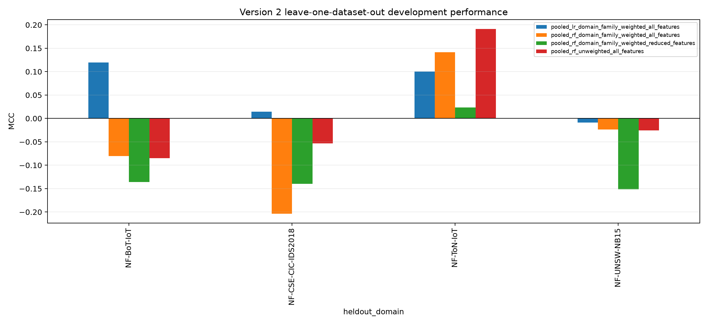
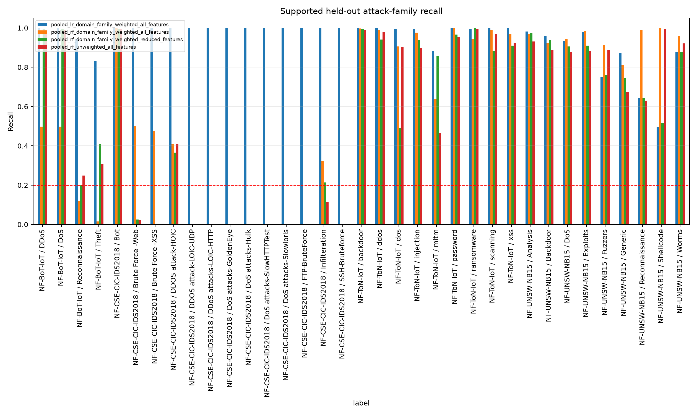
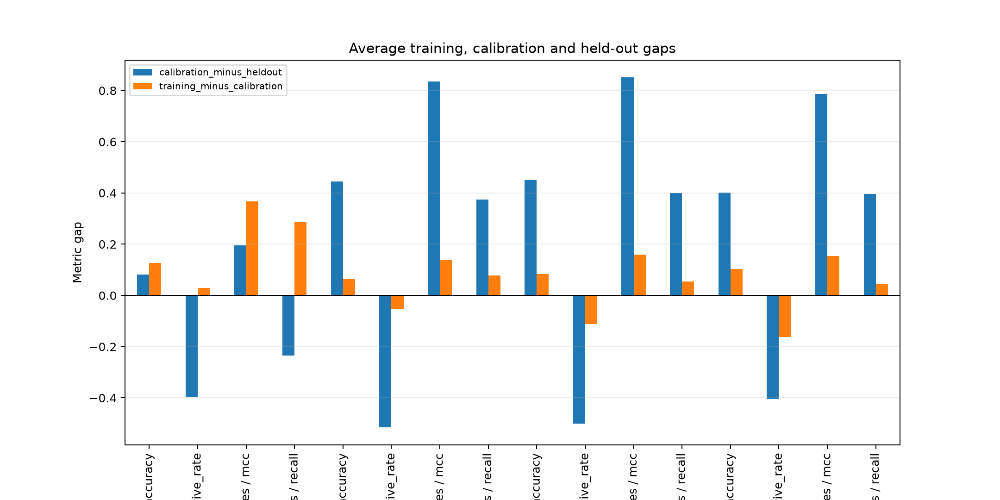

# Version 2 Multi-Domain Development Result

## Material Passport

- Origin Skill: academic-research-suite / experiment-agent
- Origin Mode: run and validate
- Origin Date: 2026-10-27
- Verification Status: VERIFIED
- Version Label: v2_generalisation_development_result_v1

## Outcome

The registered four-fold leave-one-dataset-out experiment completed all 16
candidate-fold evaluations. The fixed verdict is:

**No Version 2 candidate selected.**

No candidate passed every threshold, worst-domain, supported-attack and
false-positive requirement. Consequently, this run produces no promoted model,
no independent confirmation claim and no deployment claim.

## Aggregate candidate results

| Candidate | Macro MCC | Worst-domain MCC | Worst-domain balanced accuracy | Minimum supported-attack recall | Maximum domain FPR | Promotion eligible |
|---|---:|---:|---:|---:|---:|---|
| Weighted Logistic Regression, eight features | 0.05632 | -0.00885 | 0.49242 | 0.49670 | 0.99812 | No |
| Weighted Random Forest, eight features | -0.04151 | -0.20373 | 0.35931 | 0.00000 | 0.96826 | No |
| Weighted Random Forest, five features | -0.10086 | -0.15109 | 0.28203 | 0.00000 | 0.96027 | No |
| Unweighted Random Forest reference | 0.00674 | -0.08508 | 0.36131 | 0.00000 | 0.87022 | No |

Weighted Logistic Regression had the best macro MCC and improved it by 0.04958
over the reference, narrowly below the registered 0.05 improvement requirement.
That near miss does not alter the verdict because it also failed eligibility:
its worst-domain balanced accuracy was below 0.50, its maximum false-positive
rate was 0.99812, and its source-calibration threshold constraints did not pass
in all folds.

## Domain results reveal the trade-off

The best held-out MCC in each domain was:

| Held-out domain | Best candidate in that domain | MCC | Balanced accuracy | Recall | False-positive rate |
|---|---|---:|---:|---:|---:|
| NF-UNSW-NB15 | Weighted Logistic Regression | -0.00885 | 0.49242 | 0.83872 | 0.85388 |
| NF-ToN-IoT | Unweighted Random Forest | 0.19120 | 0.56992 | 0.93449 | 0.79466 |
| NF-BoT-IoT | Weighted Logistic Regression | 0.11959 | 0.58730 | 0.95337 | 0.77877 |
| NF-CSE-CIC-IDS2018 | Weighted Logistic Regression | 0.01444 | 0.50090 | 0.99992 | 0.99812 |

The high recalls are not operational success. They are commonly accompanied by
false-positive rates between 0.78 and 1.00, meaning that the candidate labels
most benign traffic as malicious. Conversely, the Random Forests reduce some
false positives but miss supported attack families and have negative MCC in
several domains.

Across the 35 held-out attack/domain strata with at least 100 attacks, Logistic
Regression kept every recall above 0.20, but only by accepting excessive false
positives. The three Random Forest candidates each had at least ten supported
strata below 0.20 recall; every Random Forest had a minimum supported-family
recall of zero.

## Threshold and overfitting checks

No candidate satisfied the registered source-calibration threshold constraints
in all four folds. All candidates failed those constraints in the NF-UNSW-NB15,
NF-ToN-IoT and NF-BoT-IoT holdout folds. In the NF-CSE-CIC-IDS2018 fold, the
three Random Forest thresholds passed source constraints, but their held-out
MCC values remained negative.

The average calibration-to-held-out MCC gap was 0.19528 for Logistic Regression
and ranged from 0.78717 to 0.85095 for the Random Forest candidates. This is
direct evidence that strong source calibration results did not transfer to a
different dataset domain.

## Repeated-group limitation

The registered sampling retained whole five-significant-digit groups. This
protected group separation but exposed a second problem: a few groups are so
large that nominal row caps do not create diverse samples. For example:

- NF-CSE-CIC-IDS2018 training retained 299,372 rows from only 13 groups;
- NF-ToN-IoT calibration retained 105,627 rows from only 111 groups; and
- NF-BoT-IoT training retained 330,348 rows from 602 groups.

These counts are consistent with the earlier repeated-group audit. The protocol
was followed, so the run is valid as a test of the registered design, but the
concentrated samples limit the benefit of domain and attack-family weighting.

## What the result means

The experiment rejects the idea that dataset/family weighting and moderate
Random Forest regularisation are sufficient to solve the observed
generalisation failure. It also shows why accuracy or recall alone would be
misleading: recall can be made high by producing an unusable false-alert rate.

A future protocol should change the representation and the influence of very
large groups, rather than simply add more hyperparameter search. Reasonable
hypotheses include per-group contribution caps, group-balanced loss, richer
non-endpoint features that are consistently defined across domains, or raw
flow/session information. Those are new experiments and are not validated by
this result.

## Evidence

- `../../protocols/v2_generalisation_development_protocol.json`
- `../../protocols/v2_generalisation_implementation_amendment_001.json`
- `../../protocols/v2_generalisation_execution_attempt_002.json`
- `../../artifacts/v2_generalisation_development/summary.json`
- `../../artifacts/v2_generalisation_development/fold_metrics.csv`
- `../../artifacts/v2_generalisation_development/aggregate_candidate_metrics.csv`
- `../../artifacts/v2_generalisation_development/per_attack_recall.csv`
- `../../artifacts/v2_generalisation_development/paired_group_bootstrap_intervals.csv`

## Interpretation boundary

All four datasets were previously opened and are development domains. The
leave-one-dataset-out design is stronger development evidence than a single
mixed validation partition, but it is not an untouched external confirmation.
No real-world or deployment-readiness claim is supported.
